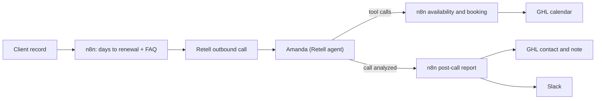

# Lone Star Insurance: Policy Renewal Voice Agent

An outbound AI voice agent that calls insurance clients 60 to 90 days before their policy renews, checks whether their coverage still fits, and books a review with their agent when it doesn't. Built on Retell AI, n8n and GoHighLevel.

## What it does

- n8n receives a client record, works out the days until renewal, loads the FAQ from a Google Doc, and starts an outbound call through Retell.
- "Amanda" asks two qualifying questions: any life changes in the past year (new car, teen driver, move, home improvements), and whether the client is happy with their coverage.
- A yes to either question leads to a review appointment with the client's assigned agent, booked on the calendar during the call. A no to both confirms auto-renewal.
- After the call, n8n updates GoHighLevel (GHL), adds a note and posts a Slack message to the team.

## How it works



## What's in this repo

```
agents/    Retell agent config
prompts/   Full agent prompt
n8n/       The n8n workflow: outbound call start, availability and booking, post-call report
```

## Stack

| Layer | Tool |
|---|---|
| Voice agent | Retell AI (gpt-4.1 at temperature 0, Cartesia voice) |
| Orchestration | n8n |
| CRM and calendar | GoHighLevel |
| Knowledge base | Google Docs, passed in by n8n |
| Alerts | Slack |

## Agent setup

- Tools: `check_availability`, `book_appointment`, `agent_transfer` and `end_call`.
- Voicemail: the agent hangs up instead of leaving a message.
- Maximum call length: just under 7 minutes.
- Post-call analysis: life change found and its details, coverage satisfaction and the reason, qualification result (`Need Review`, `Auto Renewal` or `Not Available`), appointment booked, and a new email if the client gives one.

## Key design decisions

- **Two questions decide the call.** Life changes and coverage satisfaction are the two signals that a policy needs a human review, so the agent asks only those before deciding.
- **The agent keeps going when a client says "just renew it".** It still asks both questions, so a client who has changed cars or added a driver isn't auto-renewed on the wrong coverage.
- **Context computed before the call.** n8n works out the days until renewal and formats the renewal date, so the agent never does date math.
- **FAQ passed per call.** Objection and FAQ answers live in a Google Doc that n8n sends as a dynamic variable. The agency edits the doc, not the agent.
- **Exact availability wording.** The agent reads the soonest slot exactly as n8n returns it, so it never invents a time.
- **Routing by result.** The post-call report branches on the qualification result, with separate GHL updates, notes and Slack messages for a review and for an auto-renewal.

## Placeholders

| Placeholder | Replace with |
|---|---|
| `your-n8n-instance.example.com` | Your n8n base URL |
| `YOUR_WEBHOOK_PATH` | The webhook paths you choose |
| `YOUR_GHL_LOCATION_ID` | Your GHL location ID |
| `YOUR_GHL_CALENDAR_ID` | Your GHL calendar ID |
| `YOUR_GHL_USER_ID_2`, `YOUR_GHL_USER_ID_3`, `YOUR_GHL_USER_ID_4` | Your GHL staff user IDs |
| `YOUR_OUTBOUND_PHONE_NUMBER` | The phone number that places the calls |
| `YOUR_RETELL_AGENT_ID` | Your Retell agent ID |
| `YOUR_KNOWLEDGE_BASE_DOC_ID` | Your knowledge-base Google Doc ID |
| `YOUR_SLACK_CHANNEL_ID` | Your team's Slack channel |

## License

All rights reserved. Published for viewing only. See [LICENSE](LICENSE).
